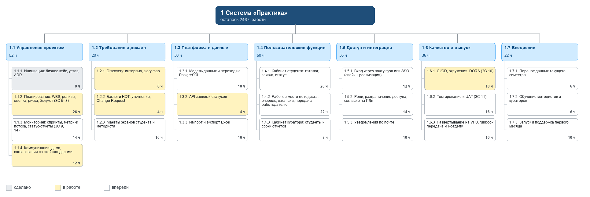
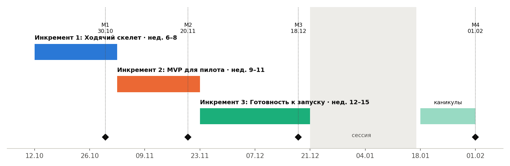
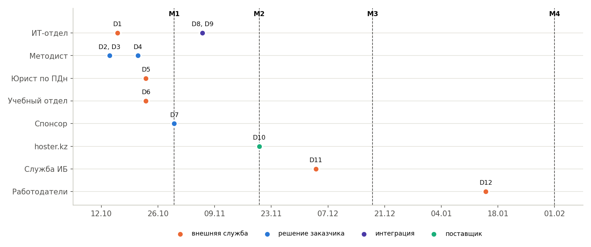
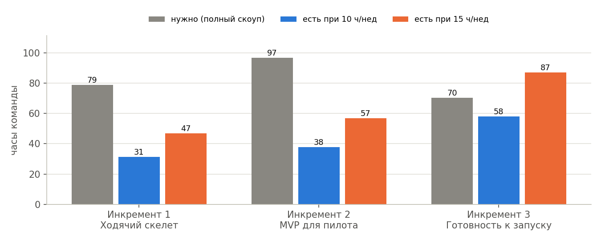

# ЛЗ 5. WBS, план релизов и карта зависимостей проекта «Практика»

_Управление IT-проектами · Неделя 5 · 4 курс бакалавриата · осень 2026_

Артефакты ЗС 5: WBS до 3-го уровня и словарь на 5 пакетов (часть 1), план релизов из 3 инкрементов с вехами (часть 2), карта зависимостей (часть 3), топология команд и RACI (часть 4), расчёт capacity (часть 5). Исходные данные лежат в репозитории в docs/planning/ (YAML), расчёты — в planning.py, так что любую цифру можно пересчитать.

> Главный вывод: при 10 часах в неделю на человека команда успевает 52% оставшейся работы (127 из 246 ч). Чтобы успеть всё, нужно около 19 ч в неделю на каждого. Решение — в части 5.

## Часть 1. WBS

WBS построена по результатам (что сдаём), а не по действиям, и соблюдает правило 100 %: всё, что команда делает в проекте, включая лабораторные артефакты, лежит ровно в одном пакете 3-го уровня. Часы — оставшаяся работа с 12.10.2026; сделанное в ЛЗ 1–4 и прототип имеют 0 ч. Оценки — предварительные, их проверим покером планирования в ЗС 6.

_Рис. 1. WBS проекта до 3-го уровня (часы — оставшаяся работа)_

| Код | Пакет работ | Часы | Статус | Инкремент | Ответственный | Истории |
|---|---|---|---|---|---|---|
| 1.1.1 | Инициация: бизнес-кейс, устав, ADR | 0 | сделано | — | Бекмағанбет Әлібек |  |
| 1.1.2 | Планирование: WBS, релизы, оценка, риски, бюджет (ЗС 5–8) | 26 | в работе | весь семестр | Бекмағанбет Әлібек |  |
| 1.1.3 | Мониторинг: спринты, метрики потока, статус-отчёты (ЗС 9, 14) | 14 | впереди | весь семестр | Бекмағанбет Әлібек |  |
| 1.1.4 | Коммуникации: демо, согласования со стейкхолдерами | 12 | в работе | весь семестр | Бекмағанбет Әлібек |  |
| 1.2.1 | Discovery: интервью, story map | 6 | в работе | Инкремент 1 | Зият Нұркен |  |
| 1.2.2 | Бэклог и НФТ: уточнение, Change Request | 4 | в работе | весь семестр | Зият Нұркен |  |
| 1.2.3 | Макеты экранов студента и методиста | 10 | впереди | Инкремент 1 | Зият Нұркен |  |
| 1.3.1 | Модель данных и переход на PostgreSQL | 10 | впереди | Инкремент 2 | Бекмағанбет Әлібек |  |
| 1.3.2 | API заявок и статусов | 4 | в работе | Инкремент 1 | Бекмағанбет Әлібек | S04, S05, S07 |
| 1.3.3 | Импорт и экспорт Excel | 16 | впереди | Инкремент 3 | Бекмағанбет Әлібек | S14, S18 |
| 1.4.1 | Кабинет студента: каталог, заявка, статус | 20 | впереди | Инкремент 1 | Бекмағанбет Әлібек | S01, S04, S05 |
| 1.4.2 | Рабочее место методиста: очередь, вакансии, передача работодателю | 22 | впереди | Инкремент 1 | Бекмағанбет Әлібек | S02, S07, S08 |
| 1.4.3 | Кабинет куратора: студенты и сроки отчётов | 8 | впереди | Инкремент 2 | Зият Нұркен | S11 |
| 1.5.1 | Вход через почту вуза или SSO (спайк + реализация) | 12 | впереди | Инкремент 2 | Бекмағанбет Әлібек | S19 |
| 1.5.2 | Роли, разграничение доступа, согласие на ПДн | 14 | впереди | Инкремент 2 | Бекмағанбет Әлібек | S15, S16 |
| 1.5.3 | Уведомления по почте | 10 | впереди | Инкремент 2 | Зият Нұркен | S10 |
| 1.6.1 | CI/CD, окружения, DORA (ЗС 10) | 10 | в работе | Инкремент 2 | Зият Нұркен |  |
| 1.6.2 | Тестирование и UAT (ЗС 11) | 16 | впереди | Инкремент 2 | Зият Нұркен |  |
| 1.6.3 | Развёртывание на VPS, runbook, передача ИТ-отделу | 10 | впереди | Инкремент 3 | Зият Нұркен |  |
| 1.7.1 | Перенос данных текущего семестра | 6 | впереди | Инкремент 3 | Зият Нұркен |  |
| 1.7.2 | Обучение методистов и кураторов | 6 | впереди | Инкремент 3 | Зият Нұркен |  |
| 1.7.3 | Запуск и поддержка первого месяца | 10 | впереди | Инкремент 3 | Бекмағанбет Әлібек |  |

Итого 246 ч: продукт 190 ч, управление и документы, идущие весь семестр, — 56 ч. Для сравнения: в бизнес-кейсе ЛЗ 3 (допущение A7) заложено 600 ч — это оценка подрядчика «с нуля». У нас уже есть прототип API, поэтому снизу вверх получается меньше. A7 обновим через Change Request, на рекомендацию бизнес-кейса это не влияет: вариант В3-С остаётся лучшим.

### Словарь WBS: 5 ключевых пакетов

| Поле | 1.4.1 Кабинет студента: каталог, заявка, статус |
|---|---|
| Описание | Веб-интерфейс студента поверх готового API: каталог открытых мест с фильтрами, карточка вакансии, кнопка «Подать заявку», список «Мои заявки» со статусом. |
| Результат | Страницы каталога, карточки и «Мои заявки»; автотесты сценария «нашёл → подал → увидел статус». |
| Критерии приёмки | Критерии S01, S04, S05 выполнены на стенде; страница работает при ширине 360 px (NFR-14); p95 ≤ 800 мс (NFR-01). |
| Оценка | 20 ч · Инкремент 1 |
| Ответственный | Бекмағанбет Әлібек |
| Зависит от | 1.3.2 API; 1.2.3 макеты; 1.5.1 вход (до инкремента 2 — демо-вход) |
| Риск | Нет опыта фронтенда в команде — берём простой серверный рендеринг (Jinja) вместо SPA. |

| Поле | 1.4.2 Рабочее место методиста: очередь, вакансии, передача работодателю |
|---|---|
| Описание | Рабочее место методиста: очередь новых заявок по сроку вакансии, форма вакансии, передача пакета заявок работодателю одним действием. |
| Результат | Очередь заявок, форма вакансии, действие «Передать работодателю» с письмом HR. |
| Критерии приёмки | Критерии S02, S07, S08; методист проходит сценарий на демо недели 8 без подсказок команды. |
| Оценка | 22 ч · Инкремент 1 |
| Ответственный | Бекмағанбет Әлібек |
| Зависит от | 1.3.2 API; 1.5.3 почта (для S08); решение методиста о тексте письма HR |
| Риск | Методист доступен раз в 2–3 недели (риск №1 из ЛЗ 1) — демо назначаем заранее. |

| Поле | 1.5.2 Роли, разграничение доступа, согласие на ПДн |
|---|---|
| Описание | Четыре роли (студент, методист, куратор, администратор), проверка прав на каждом эндпоинте, обязательное согласие на обработку ПДн с датой. |
| Результат | Модель ролей, проверки доступа, экран согласия, тесты «чужая роль → 403». |
| Критерии приёмки | S15, S16; NFR-06 (100 % эндпоинтов покрыты тестами доступа), NFR-10. |
| Оценка | 14 ч · Инкремент 2 |
| Ответственный | Бекмағанбет Әлібек |
| Зависит от | 1.5.1 вход; текст согласия от юриста по ПДн |
| Риск | Юрист не успеет согласовать текст — используем типовой текст вуза и помечаем как временный. |

| Поле | 1.3.3 Импорт и экспорт Excel |
|---|---|
| Описание | Импорт текущей Excel-таблицы карьерного центра с отчётом об ошибках и выгрузка списка принятых студентов для приказа. |
| Результат | Импорт .xlsx с отчётом по строкам, экспорт .xlsx/.csv для учебного отдела. |
| Критерии приёмки | S14, S18, NFR-15 (1 000 строк ≤ 1 мин), NFR-16 (расхождение числа строк = 0). |
| Оценка | 16 ч · Инкремент 3 |
| Ответственный | Бекмағанбет Әлібек |
| Зависит от | образец таблицы от методиста; формат приказа от учебного отдела; 1.3.1 модель данных |
| Риск | Таблица методиста «грязная» (объединённые ячейки, разные форматы дат) — закладываем час на ручную чистку. |

| Поле | 1.6.3 Развёртывание на VPS, runbook, передача ИТ-отделу |
|---|---|
| Описание | Развёртывание на VPS в Казахстане, резервное копирование, runbook для ИТ-отдела, передача поддержки. |
| Результат | Рабочий стенд, ежесуточный бэкап, runbook, акт передачи ИТ-отделу. |
| Критерии приёмки | NFR-04 (тест восстановления), NFR-05 (HTTPS), NFR-17 (сотрудник ИТ-отдела разворачивает по runbook ≤ 30 мин без нашей помощи). |
| Оценка | 10 ч · Инкремент 3 |
| Ответственный | Зият Нұркен |
| Зависит от | согласие ИТ-отдела на поддержку (go / no-go №2); VPS hoster.kz; 1.6.1 CI/CD |
| Риск | ИТ-отдел не берёт поддержку — по бизнес-кейсу ЛЗ 3 тогда не запускаемся. |

## Часть 2. План релизов на семестр

Модель поставки — Hybrid (ADR-001): снаружи вехи по неделям курса, внутри инкремента — итерации с демо методисту. Инкременты нарезаны по story map из ЛЗ 4: сначала тонкий сквозной сценарий, потом всё, без чего нельзя пустить реальных пользователей, потом перенос данных и передача системы.

_Рис. 2. План релизов: инкременты, вехи M1–M4, сессия и каникулы_

### Инкремент 1. Ходячий скелет — недели 6–8

Цель: Методист проходит сквозной сценарий «вакансия → заявка студента → очередь методиста → статус у студента» на стенде.

Содержание: истории S01, S02, S04, S05, S07, S08; пакеты WBS: 1.2.1, 1.2.3, 1.3.2, 1.4.1, 1.4.2.

Веха M1 «Демо ходячего скелета методисту» — 30.10.2026. Критерии готовности вехи:

- Сценарий S01→S04→S07→S05 проходит на стенде без подсказок команды
- Все тесты и CI зелёные
- Методист письменно подтвердил демо или дал замечания (протокол)
- Макеты экранов согласованы

### Инкремент 2. MVP для пилота — недели 9–11

Цель: Система готова к реальным пользователям — вход, роли, согласие на ПДн, уведомления, кабинет куратора.

Содержание: истории S10, S11, S15, S16, S19; пакеты WBS: 1.3.1, 1.4.3, 1.5.1, 1.5.2, 1.5.3, 1.6.1, 1.6.2.

Веха M2 «MVP на стенде, UAT с методистом» — 20.11.2026. Критерии готовности вехи:

- Протокол UAT подписан методистом
- NFR-01, 05, 06, 08, 10 проверены
- Модель угроз и чек-лист соответствия пройдены (ЗС 7)
- Пайплайн CI/CD разворачивает стенд автоматически

### Инкремент 3. Готовность к запуску — недели 12–15

Цель: Данные перенесены, ИТ-отдел умеет разворачивать и поддерживать систему, пользователи обучены.

Содержание: истории S14, S18; пакеты WBS: 1.3.3, 1.6.3, 1.7.1, 1.7.2, 1.7.3.

Веха M3 «Защита проекта (сдача курса)» — 18.12.2026. Критерии готовности вехи:

- Акт сверки перенесённых данных подписан (NFR-16)
- Сотрудник ИТ-отдела развернул систему по runbook ≤ 30 мин (NFR-17)
- Обучение проведено, инструкции переданы
- Go / no-go запуска подписан спонсором

Веха M4 «Запуск пилота» — 01.02.2027, после каникул. Решение принимает спонсор по чек-листу go / no-go из бизнес-кейса: замер методиста подтвердил эффект, ИТ-отдел принял поддержку, UAT подписан.

## Часть 3. Карта зависимостей

12 зависимостей от людей и организаций вне команды. У каждой есть владелец с нашей стороны (кто добивается ответа) и дата, к которой нужно подтверждение, иначе сдвигается веха. Структурная схема в формате Mermaid лежит в docs/planning/dependencies.mmd (GitHub рисует её прямо в браузере). Ниже — те же зависимости на шкале времени.

_Рис. 3. Когда каждая зависимость должна быть подтверждена (пунктир — вехи)_

| ID | От кого | Тип | Что нужно | Для пакета | Владелец | Подтвердить до | Блокирует |
|---|---|---|---|---|---|---|---|
| D1 | ИТ-отдел | внешняя служба | Согласие на поддержку ≤ 4 ч/мес и размещение (go / no-go №2) | 1.6.3 | Бекмағанбет Әлібек | 16.10.2026 | M4 |
| D2 | Методист | решение заказчика | Замер времени на сведение заявок за 2 недели (go / no-go №1, допущение A3) | 1.1.2 | Бекмағанбет Әлібек | 14.10.2026 | M1 |
| D3 | Методист | решение заказчика | Время для демо на неделе 8 и UAT на неделе 11 | 1.1.4 | Бекмағанбет Әлібек | 14.10.2026 | M1 |
| D4 | Методист | решение заказчика | Образец текущей Excel-таблицы заявок | 1.3.3 | Зият Нұркен | 21.10.2026 | M3 |
| D5 | Юрист по ПДн | внешняя служба | Текст согласия и срок хранения данных (NFR-10, NFR-11) | 1.5.2 | Зият Нұркен | 23.10.2026 | M2 |
| D6 | Учебный отдел | внешняя служба | Формат выгрузки для приказа о практике (S18) | 1.3.3 | Зият Нұркен | 23.10.2026 | M3 |
| D7 | Спонсор | решение заказчика | Утверждение бюджета эксплуатации из бизнес-кейса | 1.6.3 | Бекмағанбет Әлібек | 30.10.2026 | M4 |
| D8 | ИТ-отдел | интеграция | Почтовый ящик / SMTP для уведомлений | 1.5.3 | Бекмағанбет Әлібек | 06.11.2026 | M2 |
| D9 | ИТ-отдел | интеграция | Вход через почту вуза или SSO (спайк S19) | 1.5.1 | Бекмағанбет Әлібек | 06.11.2026 | M2 |
| D10 | hoster.kz | поставщик | VPS Cloud 1-2-50 и сервер резервных копий в РК | 1.6.3 | Зият Нұркен | 20.11.2026 | M3 |
| D11 | Служба ИБ | внешняя служба | Разрешение на публикацию в интернет после модели угроз | 1.6.3 | Зият Нұркен | 04.12.2026 | M3 |
| D12 | Работодатели | внешняя служба | Контакты HR и согласие получать пакеты заявок | 1.7.3 | Бекмағанбет Әлібек | 15.01.2027 | M4 |

Решения, ожидающие заказчика: D2 (замер — первое условие go / no-go), D3 (время на демо и UAT), D4 (образец таблицы), D7 (бюджет эксплуатации). Критическая цепочка: D1 → 1.6.3 → M4. Если ИТ-отдел не возьмёт поддержку до 16.10, запуск по бизнес-кейсу не делаем, а инкремент 3 превращается в передачу документации.

## Часть 4. Топология команд и роли

| Команда (Team Topologies) | Кто | Режим взаимодействия с нами |
|---|---|---|
| Stream-aligned — поток «практика студента» | Наша команда: Бекмағанбет Әлібек, Зият Нұркен | Владеет продуктом целиком: от требований до запуска |
| Platform | ИТ-отдел университета: сервер, почта, резервные копии, вход | X-as-a-Service: берём готовые сервисы по запросу (D1, D8, D9) |
| Enabling | Преподаватель курса, служба ИБ на этапе модели угроз | Facilitating: учат и проверяют, но работу не делают за нас |
| Complicated-subsystem | Нет | Интеграция с ИС успеваемости вынесена из скоупа (устав) |

Почему так: команда из двух человек не потянет свою инфраструктуру — когнитивная нагрузка уйдёт в серверы вместо продукта. Поэтому стек простой (ADR-002), а всё, что ИТ-отдел умеет делать как сервис, берём у него.

### Роли и зоны ответственности

| Участник | Роль | Отвечает за |
|---|---|---|
| Бекмағанбет Әлібек | PM, бэкенд | План и вехи, коммуникация со спонсором и методистом, API, кабинеты студента и методиста, импорт/экспорт |
| Зият Нұркен | Аналитик, QA, DevOps | Бэклог и НФТ, макеты, уведомления, кабинет куратора, CI/CD, тестирование и UAT, развёртывание, обучение |

### RACI на ключевые артефакты

R — делает, A — отвечает за результат (ровно один на строку), C — консультирует, I — информируется.

| Артефакт | Әлібек (PM) | Нұркен (BA/QA) | Методист | Спонсор | ИТ-отдел | Преподаватель |
|---|---|---|---|---|---|---|
| Бэклог и приоритеты | C | R | A | I |  |  |
| WBS, план релизов, capacity | A/R | C | C | I |  | I |
| Нефункциональные требования | C | A/R | C |  | C |  |
| API и интерфейсы | A/R | R | C |  |  |  |
| CI/CD и окружения | I | A/R |  |  | C |  |
| Протокол UAT | C | R | A | I |  |  |
| Развёртывание и runbook | A | R | I |  | C |  |
| Перенос данных (акт сверки) | C | R | A |  |  |  |
| Статус-отчёт спонсору | A/R | C | I | I |  |  |
| Go / no-go запуска | R | C | C | A | C |  |
| Сдача лабораторных | A/R | R |  |  |  | I |

## Часть 5. Capacity команды на семестр

Считаем реальные часы, а не «по 40 часов в неделю». Формула: человек × часы в неделю × доля недели × фокус-фактор × (1 − резерв).

- [C1] 10 ч в неделю на человека: лекция и лабораторная плюс самостоятельная работа по курсу. У обоих ещё 5–6 предметов, проект — не единственная нагрузка.
- [C2] Фокус-фактор 0.7: встречи, переключения, ревью съедают около 30 % времени.
- [C3] Резерв 10% на болезни и непредвиденное.
- [C4] Неделя 8 — рубежный контроль и выходной 26.10 за День Республики (0,48 недели); неделя 14 — второй рубежный контроль (0,6); неделя 15 — защита, сессия и 16.12 День Независимости (0,4).
- [C5] Сессия — проектом не занимаемся; каникулы 18–31.01.2027 — по 8 ч в неделю, если команда согласна.

| Неделя | нед. 6 | нед. 7 | нед. 8 | нед. 9 | нед. 10 | нед. 11 | нед. 12 | нед. 13 | нед. 14 | нед. 15 | янв. 1 | янв. 2 | Итого |
|---|---|---|---|---|---|---|---|---|---|---|---|---|---|
| Часы команды | 13 | 13 | 6 | 13 | 13 | 13 | 13 | 13 | 8 | 5 | 10 | 10 | 127 |

### Хватает ли часов

| Сценарий | Capacity, ч | Нужно, ч | Покрытие |
|---|---|---|---|
| 8 ч/нед | 102 | 246 | 41% |
| 10 ч/нед | 127 | 246 | 52% |
| 15 ч/нед | 191 | 246 | 77% |
| 15 ч/нед + CR-001 | 191 | 216 | 88% |
| 20 ч/нед | 254 | 246 | 103% |

_Рис. 4. Часы по инкрементам: сколько нужно и сколько есть_

При 10 ч в неделю команда закрывает 52% работы. Больше всего не хватает в инкрементах 1 и 2: на них же приходятся лабораторные и рубежный контроль. Чтобы успеть весь скоуп, каждому нужно около 19 ч в неделю — нереально для 4 курса с другими предметами.

### Решение: три шага вместо «будем стараться»

1. Каждый участник выделяет 15 ч в неделю — договорённость фиксируем в протоколе команды.
2. Change Request CR-001 убирает из семестра 30 ч: 1.3.1 — PostgreSQL — после пилота; на пилоте остаётся SQLite (нагрузка 30–40 заявок/нед, ADR-003 пересмотреть); 1.4.3 — Кабинет куратора (S11) — в релиз 2; до этого кураторы получают список просрочек письмом; 1.5.1 — Вместо SSO — вход по одноразовой ссылке на почту вуза (спайк S19 решает окончательно); 1.2.3 — Макеты — эскизы от руки и сразу HTML, без отдельного прототипа.
3. Оставшиеся ~25 ч закрываем третьим участником (курс допускает команды по 3–4 человека) или вторым Change Request. Решение — до конца недели 6.

Если ничего из этого не сделать, к M3 не будут готовы перенос данных и передача ИТ-отделу, а значит, не выполнится go / no-go запуска в феврале. Это отдельный риск в реестре ЗС 7.

## Раскрытие использования AI

По правилам курса: структура WBS, оценки часов, расчёт capacity и диаграммы подготовлены с помощью AI-ассистента Claude (Anthropic). Часы и допущения C1–C5 — предложения, которые команда пересматривает; даты зависимостей нужно согласовать с владельцами. Ответственность за содержание несёт команда.
