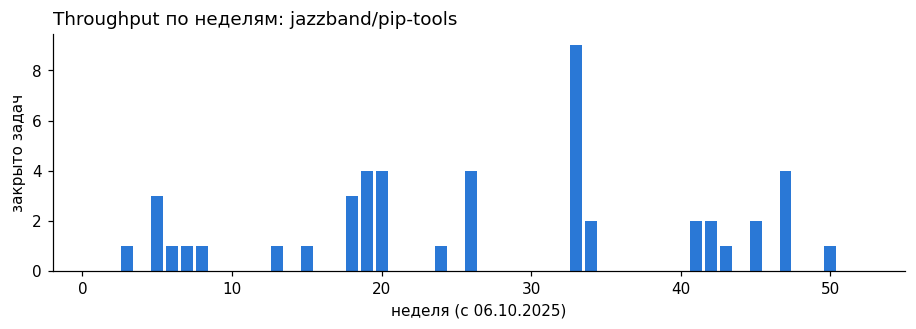
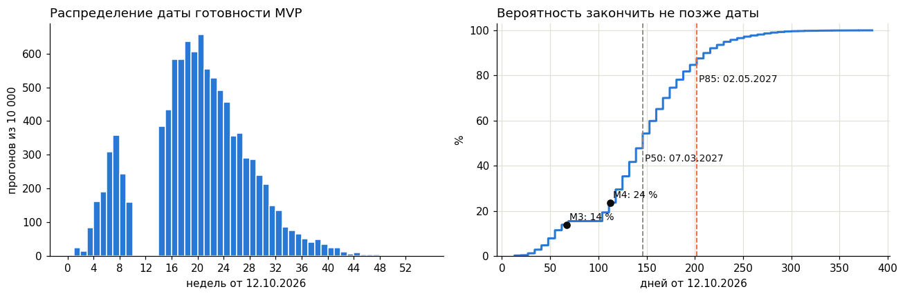
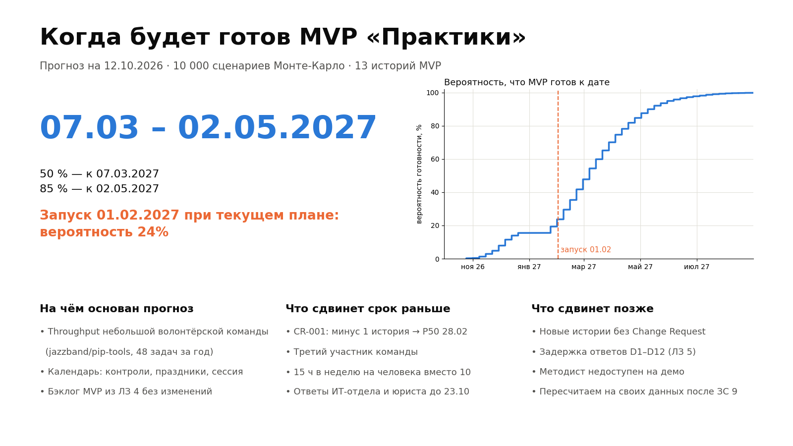

# ЛЗ 6. Вероятностный прогноз сроков MVP «Практики» (Монте-Карло)

_Управление IT-проектами · Неделя 6 · 4 курс бакалавриата · осень 2026_

Артефакты ЗС 6: notebook с симуляцией и графиками (analytics/monte_carlo.ipynb в репозитории, выполнен, воспроизводим) и слайд «Когда будет готово» для заказчика (часть 5). Покер планирования — часть 4.

> Главный вывод: MVP будет готов к 07.03.2027 с вероятностью 50 % и к 02.05.2027 с вероятностью 85 %. Запуск 01.02.2027 при текущем плане — 24%.

## Часть 1. Исторические данные throughput

Своей истории у команды ещё нет — спринты начнутся в ЗС 9. Задание разрешает взять открытый репозиторий GitHub. Мы выбрали jazzband/pip-tools: задачи там закрывает небольшая команда волонтёров, которые занимаются проектом в свободное время, как и мы между другими предметами. Крупные проекты с оплачиваемой командой закрывают 20–50 задач в неделю и дали бы бессмысленно оптимистичный прогноз.

- Период: 06.10.2025 – 04.10.2026 (52 недели), закрыто 48 задач, в среднем 0,92 в неделю.
- Недель без единой закрытой задачи: 62%. Throughput неровный: длинные паузы и всплески до 9 задач.
- Считаем только issues, закрытые как выполненные: без pull request, дублей и «не будем делать».
- Снимок выгружен скриптом analytics/fetch_throughput.py и лежит в репозитории, поэтому расчёт повторяется без интернета.

_Рис. 1. Закрытые задачи по неделям, jazzband/pip-tools_

## Часть 2. Симуляция и результат

Бэклог MVP — 13 историй (51 SP) релизов «ходячий скелет» и «MVP» из ЛЗ 4. В каждом из 10 000 прогонов идём по календарю с 12.10.2026. Для каждой недели случайно берём неделю из истории и учитываем календарь команды из ЛЗ 5: в неделю рубежного контроля работаем примерно вполовину, в сессию — ноль, на каникулах — 80 %. Прогон заканчивается, когда закрыты все истории. Генератор случайных чисел зафиксирован (seed 2026), поэтому результат воспроизводим.

_Рис. 2. Гистограмма даты готовности и кумулятивная кривая вероятности_

| Сценарий | P50 | P70 | P85 | P95 | Успеть к M3 (18.12) | Успеть к M4 (01.02) |
|---|---|---|---|---|---|---|
| MVP, 13 историй | 07.03.2027 | 28.03.2027 | 02.05.2027 | 06.06.2027 | 14% | 24% |
| MVP после CR-001, 12 | 28.02.2027 | 21.03.2027 | 18.04.2027 | 23.05.2027 | 18% | 29% |
| Весь бэклог, 20 историй | 02.05.2027 | 30.05.2027 | 04.07.2027 | 15.08.2027 | 2% | 4% |

Как читать: P85 = 02.05.2027 значит, что в 85 % сценариев MVP готов не позже этой даты. Заказчику называем диапазон P50–P85, а не одну дату.

## Часть 3. Сравнение с детерминированной оценкой

План релизов ЛЗ 5 обещает весь MVP к вехе M3. Неявно это означает 51 SP за 10 недель, то есть около 5 SP в неделю без пауз. Так получается дата 22.12.2026. По симуляции вероятность успеть к ней — 15%.

| Причина расхождения | Что это значит для нас |
|---|---|
| Среднее скрывает разброс | В 62% недель истории не закрыто ни одной задачи. План по среднему предполагает, что пустых недель не бывает. |
| Story points — не время | SP измеряют относительный размер. Перевод «5 SP в неделю» не основан на данных: собственной скорости у команды пока нет. |
| Календарь | Рубежные контроли, праздник 26.10 и четыре недели сессии есть в симуляции и отсутствуют в детерминированном плане. |
| Ожидание других | Throughput из истории включает ожидание ревью и ответов. План предполагает, что все 12 зависимостей из ЛЗ 5 подтвердят вовремя. |
| Совпадение с ЛЗ 5 | Capacity покрывает около 52 % работы. Монте-Карло с другой стороны приходит к той же картине: медиана — март, а не декабрь. |

Ограничение. Throughput взят у другой команды — это честная отправная точка, но не наша скорость. После двух спринтов (ЗС 9) меняем источник данных на выгрузку из нашего репозитория и пересчитываем. Тогда прогноз станет нашим, а не заимствованным.

## Часть 4. Покер планирования на 10 историях

> Покер проводит команда: оценки ниже не заполнены намеренно, чтобы не выдавать придуманные цифры за результат. После игры заполните analytics/planning_poker.csv и перезапустите notebook: он сам посчитает разброс мнений.

Правила проведения (30–40 минут):

1. Карты: 1, 2, 3, 5, 8, 13. Ведущий зачитывает историю и критерии приёмки из бэклога.
2. Каждый выбирает карту молча, вскрываем одновременно, чтобы первая названная оценка не тянула остальных.
3. Если оценки расходятся больше чем на одну карту, автор самой высокой и самой низкой объясняет причину. Причины записываем: это и есть главный результат покера.
4. Второй раунд. Если согласия нет, берём большую оценку и заводим спайк на неясную часть.

Для сравнения в таблице есть независимая оценка AI-ассистента (Claude) с причинами. Это не голос команды: она нужна, чтобы обсудить расхождения. Где ваши голоса разойдутся с ней больше чем на карту, причину стоит записать.

| История | Название | SP в ЛЗ 4 | Оценка AI и причина | Раунд 1: Әлібек / Нүркен | Итог команды |
|---|---|---|---|---|---|
| S01 | Список открытых мест практики с фильтрами | 3 | 3 — API каталога уже есть; нужны страница, фильтры и пустое состояние |  |  |
| S02 | Методист добавляет вакансию партнёра через форму | 3 | 2 — POST /vacancies готов; остаётся форма и проверка полей |  |  |
| S04 | Подача заявки на вакансию | 5 | 3 — Проверка дублей и дедлайна уже в API; нужен интерфейс и сообщения об ошибках |  |  |
| S05 | Студент видит статус своих заявок | 3 | 2 — Данные и статусы есть; список «Мои заявки» зависит только от входа |  |  |
| S07 | Очередь новых заявок для методиста | 3 | 3 — Сортировка по сроку вакансии и смена статуса прямо из очереди |  |  |
| S08 | Передача пакета заявок работодателю | 5 | 5 — Массовая смена статусов и письмо HR; зависит от почты вуза (D8) |  |  |
| S10 | Уведомление студента о смене статуса | 5 | 5 — Очередь отправки, 3 повтора и журнал (NFR-18); зависит от SMTP (D8) |  |  |
| S14 | Импорт текущей Excel-таблицы заявок | 5 | 8 — Таблица методиста ещё не получена (D4); грязные данные, отчёт об ошибках, сверка строк |  |  |
| S15 | Согласие на обработку персональных данных | 2 | 2 — Поле согласия уже в базе; экран и дата, текст ждём от юриста (D5) |  |  |
| S16 | Роли и разграничение доступа | 8 | 8 — 4 роли × все эндпоинты, тесты 403 (NFR-06); зависит от способа входа (S19) |  |  |

Оценка AI расходится с ЛЗ 4 в 4 историях из 10 (S02, S04, S05, S14). S02, S04 и S05 AI оценивает ниже: часть логики уже есть в прототипе API. S14 — выше: образца таблицы ещё нет, а «грязные» данные обычно съедают больше времени, чем кажется.

На что обратить внимание: истории с внешней зависимостью (S08 — письмо работодателю, S10 — почта вуза, S14 — образец таблицы от методиста, S16 — роли и ИБ) обычно дают самый большой разброс. Оценка зависит от того, что каждый предполагает о чужом ответе.

## Часть 5. Слайд «Когда будет готово» для заказчика

_Рис. 3. Слайд для методиста и спонсора_

На слайде три вещи, которых заказчик обычно не получает: диапазон вместо даты, вероятность успеть к нужной ему дате и честный список того, что сдвинет срок в обе стороны.

## Раскрытие использования AI

По правилам курса: код симуляции, выбор репозитория-источника, графики и текст подготовлены с помощью AI-ассистента Claude (Anthropic). Данные выгружены из открытого API GitHub, расчёт воспроизводим. Покер планирования проводит команда; его результаты AI не генерировал. Ответственность за содержание несёт команда.
